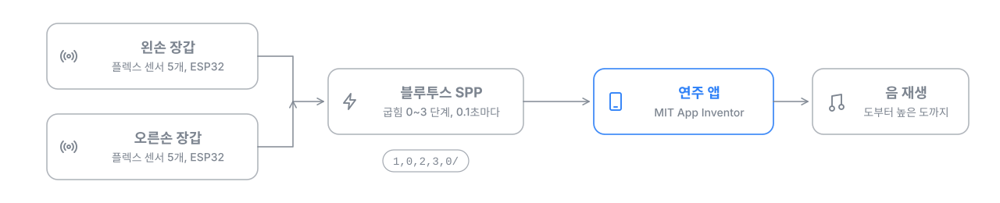

# Golden Glove

손가락을 구부리는 정도로 음을 연주하는 장갑형 음악 코딩 키트입니다. 2023년 캡스톤 디자인 팀 프로젝트로 진행했으며, 장갑 펌웨어(ESP32)와 연주 앱 개발을 맡았습니다.

## 동작 방식

- 양손 장갑의 손가락마다 플렉스 센서를 달고, ESP32가 굽힘 정도를 0~3 단계로 바꿉니다.
- 다섯 손가락 값을 `1,0,2,3,0/` 형식으로 묶어 0.1초마다 블루투스(SPP)로 보냅니다.
- MIT App Inventor로 만든 앱이 양손 값을 받아 도부터 높은 도까지의 음을 재생합니다.

## 구성

| 경로 | 내용 |
| --- | --- |
| `Arduino/Golden_Glove_LEFT`, `Arduino/Golden_Glove_RIGHT` | 왼손, 오른손 장갑 펌웨어 |
| `Arduino/Flex_sensor_Read_LEFT`, `Arduino/Flex_sensor_Read_RIGHT` | 플렉스 센서 값 확인용 스케치 |
| `Arduino/blue_tooth_TEST` | 블루투스 연결 테스트 |
| `GoldenGlove.aia` | 연주 앱 프로젝트 (MIT App Inventor에서 가져오기) |

## 기술 스택

ESP32, Arduino, 플렉스 센서, Bluetooth SPP, MIT App Inventor
